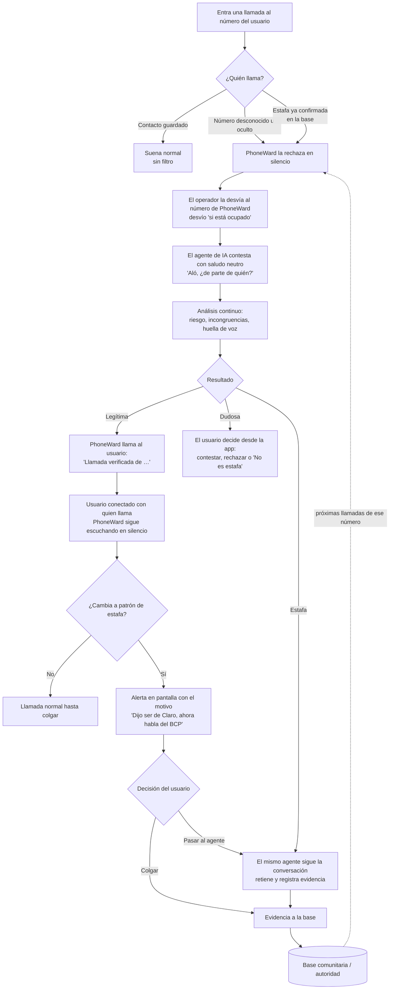
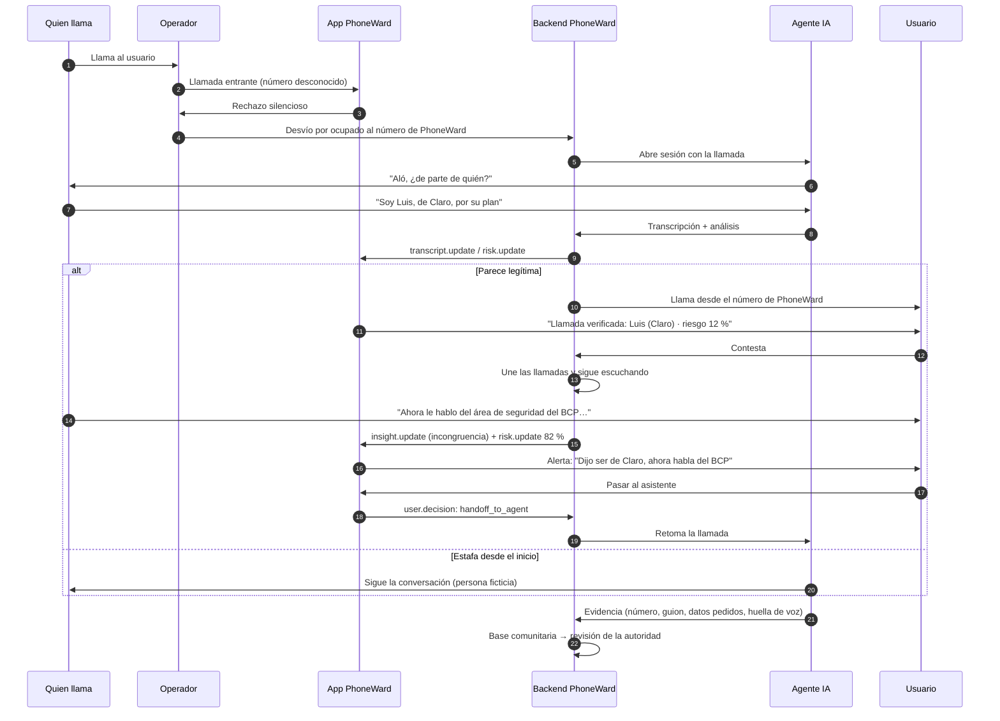
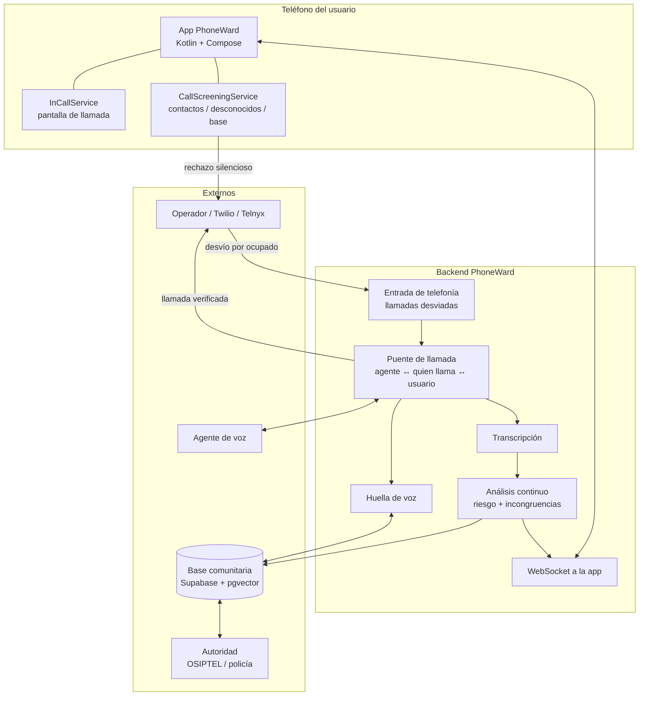

# PhoneWard: análisis del proyecto y flujo

> Track: **Seguridad: extorsión, estafas, suplantación y desinformación**.
> Modelo: **B2G** (estándar nacional), empezando por B2C para validar.
> Estado: app Android con modo demo y canal de voz WebRTC. Puente de telefonía y agente de voz pendientes.

## Índice

1. [El problema](#1-el-problema)
2. [La propuesta](#2-la-propuesta)
3. [Principios de diseño](#3-principios-de-diseño)
4. [Flujo principal](#4-flujo-principal)
5. [Arquitectura](#5-arquitectura)
6. [Responsabilidades por componente](#6-responsabilidades-por-componente)
7. [Restricciones técnicas de Android y de la red](#7-restricciones-técnicas-de-android-y-de-la-red)
8. [Modelo de negocio: B2G](#8-modelo-de-negocio-b2g)
9. [Estado del arte](#9-estado-del-arte)
10. [Análisis de SafeLine (proyecto de referencia)](#10-análisis-de-safeline-proyecto-de-referencia)
11. [Stack y costos](#11-stack-y-costos)
12. [Aspectos legales y éticos](#12-aspectos-legales-y-éticos)
13. [Estado actual y próximos pasos](#13-estado-actual-y-próximos-pasos)
14. [Fuentes](#14-fuentes)

---

## 1. El problema

Las estafas telefónicas en Perú y Latinoamérica afectan sobre todo a adultos mayores. Los patrones más comunes:

- **Familiar en apuros:** "Abuela, soy yo, tuve un accidente, necesito plata para el abogado".
- **Suplantación bancaria:** "Le hablo de seguridad del banco, dígame la clave que le llegó por SMS".
- **Suplantación de empresas:** el operador de telefonía, la aduana, el courier, una entidad del Estado.
- **Premios y subsidios falsos:** "Ganó un sorteo, solo pague los gastos".
- **Soporte técnico falso:** "Instale AnyDesk para revisar su equipo".

La respuesta habitual es **detectar y cortar**: el estafador pierde un intento, pero sigue llamando
a otras personas y no se aprende nada de él. Además, un filtro que solo actúa al inicio se puede
burlar: el estafador se porta bien hasta llegar a la víctima y recién ahí empieza el engaño.

## 2. La propuesta

PhoneWard es la app de teléfono del usuario y funciona así:

1. **Los contactos guardados suenan normal.** Sin filtro ni espera.
2. **Las llamadas desconocidas las atiende primero un agente de IA**, con un saludo neutro, sin anunciar que es un filtro.
3. **El análisis no termina al pasar la llamada.** PhoneWard escucha **toda la conversación**: la del agente con quien llama y la del usuario con quien llama. Detecta incongruencias en vivo y avisa al usuario.
4. **No hay un "modo honeypot" aparte.** El honeypot **es el mismo agente**: si quien llama resulta ser estafador, el agente simplemente se queda conversando con él, lo retiene y registra evidencia. El usuario nunca habla con el estafador.
5. **Cada estafa alimenta una base comunitaria** que, en el modelo B2G, valida la autoridad. Los números confirmados van directo al agente en las siguientes llamadas.

Mensaje para el pitch:
> *El estafador no sabe que lo están filtrando, y aunque pase el filtro portándose bien,
> PhoneWard sigue escuchando durante toda la llamada.*

## 3. Principios de diseño

| Principio | Por qué |
|---|---|
| **Fricción mínima donde no hay riesgo** | Feedback de mentoría: el valor tiene que superar con claridad la fricción que se agrega. Los contactos (la mayoría de las llamadas) no pasan por nada. |
| **Un solo agente, sin distinguir "externo" de "estafador" de antemano** | Al empezar la llamada no se sabe quién es quién. El mismo agente conversa con todos; lo que cambia es cómo termina la llamada. |
| **Análisis continuo, no un filtro de entrada** | Un estafador puede actuar como persona legítima ante el agente y cambiar de rol con el usuario. Por eso PhoneWard analiza hasta que se cuelga. |
| **El agente no se delata, pero no suplanta al usuario** | No dice "soy un filtro anti-estafas" (el estafador se pondría en guardia), pero tampoco dice ser el dueño del teléfono. Si le preguntan directamente si es una máquina, no miente. |
| **El usuario siempre decide** | PhoneWard alerta y recomienda; el usuario puede contestar, colgar o marcar "No es estafa". |

## 4. Flujo principal

### 4.1 Vista general

### 4.2 Cómo llega la llamada al agente

Android no permite que una app lea el audio de una llamada del operador (ver [sección 7](#7-restricciones-técnicas-de-android-y-de-la-red)).
Por eso la llamada desconocida tiene que pasar por el backend de PhoneWard. La forma de lograrlo **sin desviar todas las llamadas**:

1. **Una sola vez**, el usuario activa el desvío "si está ocupado" (`**67*<número de PhoneWard>#`). La app lo hace con un botón.
2. **Contacto:** PhoneWard no interviene y el teléfono suena.
3. **Desconocido o estafa confirmada:** PhoneWard (`CallScreeningService` / `InCallService`) **rechaza la llamada en silencio**. Para el operador, rechazar equivale a "ocupado", así que la desvía al número de PhoneWard. Es el mismo mecanismo que hoy envía una llamada rechazada al buzón de voz.
4. El backend recibe la llamada y conecta al agente.

**Cuando la llamada es legítima**, el backend **llama al usuario** desde el número de PhoneWard. La app reconoce ese número
y muestra "Llamada verificada" con el nombre que dio quien llama, el motivo y el riesgo. Al contestar,
el backend une ambas llamadas **y la mantiene pasando por PhoneWard**, lo que permite seguir analizándola.

A validar antes de construirlo:
- que el desvío por ocupado funcione al rechazar desde la app con cada operador (Claro, Movistar, Entel, Bitel), y su costo por minuto;
- que en la llamada desviada llegue el número original de quien llama.

### 4.3 Reglas de conversación del agente

| Regla | Ejemplo |
|---|---|
| Saludo neutro y humano, sin anunciar el filtro | "Aló, buenas. ¿De parte de quién? … ¿Y por qué motivo llama?" |
| Aviso genérico de grabación | "Esta llamada puede ser grabada." (lo usan bancos y empresas; no delata el filtro) |
| No afirmar ser el dueño del teléfono | Nunca "soy Kevin". Puede decir "le paso el recado" o "le comunico". |
| No mentir si preguntan directamente | "¿Eres un robot?" → "Soy un asistente automático." |
| Preguntas de verificación | Nombre, empresa, motivo, número para devolver la llamada. Los estafadores suelen fallar aquí. |
| Ante una estafa, persona ficticia | Si ya hay señales claras, el agente sigue la conversación como una persona ficticia (por ejemplo "la señora Rosa"), con **datos falsos**. Nunca usa la identidad ni los datos reales del usuario. |
| Límites | Nunca entrega datos reales, nunca hace transferencias, nunca devuelve la llamada al estafador, duración máxima por llamada. |

### 4.4 Análisis continuo

El análisis corre en **dos tramos** de la misma llamada:

| Tramo | Quién habla | Qué ve el usuario |
|---|---|---|
| **1. Agente ↔ quien llama** | El agente conversa con quien llama. | En la pantalla de llamada: transcripción, % de riesgo y motivos. |
| **2. Usuario ↔ quien llama** (si se conectó) | El usuario habla; PhoneWard escucha en silencio. | Indicador "PhoneWard está escuchando", el riesgo y **alertas** si cambia el patrón. |

**Señales que se evalúan en ambos tramos:**

- **Incongruencias de identidad:** dijo ser de una entidad y luego habla en nombre de otra.
  *Ejemplo:* "Soy asesor de Claro" → minutos después: "le hablo del área de seguridad del BCP".
- **Cambio de tono entre tramos:** amable y verificable con el agente; urgente y con presión con el usuario.
- **Pedidos sensibles:** claves, códigos SMS, transferencias, instalar aplicaciones, "no le cuente a nadie".
- **Datos que no cuadran:** nombre, empresa o motivo distintos a los que dio al agente.
- **Huella de voz** coincidente con voces de estafas confirmadas.
- **Reputación del número** en la base comunitaria.

**Alerta durante el tramo 2** (ejemplo):

> ⚠ **Posible estafa** · 82 %
> "Dijo ser de Claro, ahora pide datos de tu cuenta del BCP."
> [Colgar] [Pasar al asistente] [Es legítimo]

"Pasar al asistente" saca al usuario de la llamada y el agente la retoma. Para quien llama, la conversación sigue.

### 4.5 Secuencia de una llamada desconocida

### 4.6 Estados en la app

| Momento | Qué ve el usuario | Acciones |
|---|---|---|
| Contacto llamando | Pantalla normal de llamada entrante | Contestar · Rechazar |
| Desconocido en el agente (en segundo plano) | Notificación discreta "PhoneWard está atendiendo a +51…" con transcripción y riesgo al abrirla | Contestar ahora · Colgar · Dejar al asistente |
| Llamada verificada | "Llamada verificada de Luis (Claro)", motivo y riesgo | **Contestar** · Rechazar |
| En llamada, sin señales | Duración e indicador "PhoneWard está escuchando" | Silenciar · Altavoz · Colgar |
| En llamada, alerta | Banner rojo con el motivo y el % | Colgar · Pasar al asistente · Es legítimo |
| Estafa retenida por el agente | Historial: "Estafa retenida 12 min · evidencia enviada" | Ver transcripción · Reportar |

Colores de riesgo: `< 30 %` verde · `30–59 %` ámbar · `60–84 %` naranja · `≥ 85 %` rojo.

### 4.7 Qué se hace con una estafa

1. **El mismo agente la retiene**: alarga la conversación, hace repetir datos y finge dificultades. Cada minuto que el estafador pasa con el agente es un minuto sin llamar a una víctima real.
2. **Registra evidencia:** número, guion usado, entidad suplantada, datos que pidió (cuentas, nombres, enlaces), huella de voz.
3. **La envía a la base comunitaria** con estado *reportado → en revisión → confirmado por la autoridad*.
4. **Las siguientes llamadas de ese número** se rechazan y van directo al agente.

## 5. Arquitectura

## 6. Responsabilidades por componente

| Componente | Hace | No hace |
|---|---|---|
| **App PhoneWard** | Separar contactos de desconocidos, rechazar en silencio, mostrar transcripción, riesgo y alertas, decisiones del usuario, historial | No toca el audio de la llamada del operador |
| **Puente de telefonía** | Recibir la llamada desviada, conectar al agente, llamar al usuario si es legítima, mantener la llamada pasando por PhoneWard | — |
| **Agente de voz** | Conversar con quien llama según las reglas de 4.3, de principio a fin, también como persona ficticia ante una estafa | No decide solo si es estafa: lo decide el análisis |
| **Análisis continuo** | Riesgo 0–100, motivos, **incongruencias** entre lo dicho al agente y al usuario, en ambos tramos | No confirma identidades ni culpabilidad |
| **Huella de voz** | Embedding de la voz y búsqueda de similares | No detecta voces clonadas sin un anti-spoofing aparte |
| **Base comunitaria** | Números, evidencia y estados de revisión | No bloquea a nadie sin revisión en el modelo B2G |

Contrato exacto app ↔ backend: [`CONTRATO_BACKEND.md`](CONTRATO_BACKEND.md).

## 7. Restricciones técnicas de Android y de la red

- **Ser app de teléfono** (`ROLE_DIALER` + `InCallService`) da control de la **interfaz**: contestar, rechazar, colgar y mostrar la pantalla sobre el bloqueo. Es lo que hace Truecaller.
- **No da acceso al audio** de una llamada del operador. Las APIs de procesamiento de audio del filtro de llamadas son ocultas o de sistema, y desde Android 10 no se puede grabar la llamada con el micrófono.
- **Consecuencia:** el audio que analizan los agentes pasa por el backend. El desvío por ocupado y el puente (sección 4.2) resuelven esto sin desviar los contactos.
- **El canal de voz WebRTC** (pantalla "Canal de voz") analiza el **micrófono** con autorización. Sirve para demostrar el análisis en vivo y es el mismo motor que se usará sobre el audio del puente.
- **En el modelo con operadores**, el desvío lo hace la red y el usuario no configura nada.

## 8. Modelo de negocio: B2G

### 8.1 Por qué B2G

- **Efecto de red al máximo:** cada estafa reportada protege a todo el país.
- **Cero fricción:** el filtro viene de fábrica en la red; el usuario no instala ni configura nada.
- **Datos con autoridad:** un reporte validado permite **dar de baja la línea**, algo que una app privada no puede hacer.
- **Se conecta con lo que ya existe:** en Perú, OSIPTEL ya da de baja líneas vinculadas a estafa y extorsión vía RENTESEG.

### 8.2 Feedback de mentoría

- Medir siempre **valor vs. fricción**: el producto se adopta solo si el valor supera claramente la fricción.
- **"Enunciar" el número**, no solo bloquearlo: que quede marcado para todos.
- Si lo adopta un operador o el Estado, **el cliente deja de ser cada persona**: diseñar para que el operador o el regulador lo acepte.
- Evaluar ambos caminos: el operador puede decir que no; ir persona a persona es más seguro y no depende de un operador.

### 8.3 Referentes internacionales

| Capa | País | Qué estandarizaron |
|---|---|---|
| Autenticación del número | EE. UU. | STIR/SHAKEN obligatorio desde 2021; bloqueo por listas *do-not-originate*. |
| | Brasil | Medida Provisoria 1.396 (2026): autenticar y bloquear llamadas no validadas; nombre y logo de empresas. |
| | España, Costa Rica | Normas contra la suplantación por llamada y SMS (Orden TDF/149/2025; Sutel 2026). |
| | India | CNAP: nombre verificado de quien llama desde el registro del operador. |
| Lista central de estafas | **Singapur** | **ScamShield**, app del gobierno: lista central validada por la policía, reportes ciudadanos, contactos excluidos, línea para desbloquear errores. |
| | Australia | Código obligatorio para operadores; más de 246 millones de llamadas de estafa bloqueadas en un trimestre (2023). |
| Reporte ciudadano | India | Portal Chakshu y plataforma de datos compartidos entre operadores, policía y bancos. |
| IA en la llamada | **Corea del Sur** | Los tres operadores analizan la conversación en vivo y alertan (SKT avisa también a un familiar); plataforma ASAP comparte datos de fraude entre 130 entidades. |
| Llamadas comerciales | Chile | Prefijo obligatorio para televentas (Subtel; impugnado, verificar vigencia). |

**Perú hoy:** OSIPTEL actúa sobre líneas y equipos (RENTESEG, baja de líneas a pedido de la policía o la fiscalía,
"candado" contra contrataciones a tu nombre), pero **no protege a la persona durante la llamada**. Ahí entra PhoneWard.

Frase para el pitch:
> *PhoneWard es el ScamShield de Singapur con la IA en vivo de Corea, pensado para Perú y conectado
> con lo que OSIPTEL ya hace con RENTESEG.*

### 8.4 Ruta

| Etapa | Modelo | Qué se demuestra |
|---|---|---|
| 1. Hoy | **B2C** | Funciona con cualquier operador; acumula datos y la base comunitaria. |
| 2. | **Operadores** | El desvío lo hace la red; el análisis corre sobre su audio. |
| 3. | **B2G** | Estándar nacional: base validada por la autoridad, conectada a la baja de líneas. |

En B2G, la **lista de números y los reportes** pueden ser estándar obligatorio; el **análisis de la conversación con IA**
debe ser siempre **opcional y con consentimiento**, como en Singapur (solo listas) y Corea (vía operadores, a elección del usuario).

## 9. Estado del arte

### Productos

| Producto | Qué hace | Diferencia con PhoneWard |
|---|---|---|
| **Google Scam Detection (Pixel)** | Analiza la llamada en el teléfono con Gemini Nano y avisa durante la conversación. | Solo avisa; no atiende por ti ni retiene al estafador. |
| **Google Fake Call Detection (2026)** | Verifica por RCS que un contacto sea quien dice ser. | Verifica identidad, no analiza la conversación. |
| **Truecaller Assistant** | Contesta por ti, transcribe en vivo y te deja tomar la llamada. | **El más parecido.** Se anuncia como asistente, no analiza la llamada después de que contestas y no retiene estafadores. |
| **iOS 26 / Samsung Smart Call** | El teléfono contesta llamadas desconocidas y muestra la transcripción. | Filtro de entrada, sin análisis continuo. |
| **O2 "Daisy" (2024)** | "Abuela" de IA que entretiene estafadores (más de 1.000, hasta 50 min). | **No intercepta**: usa números sembrados en listas de estafadores. |
| **Operadores de Corea** | IA que analiza la llamada en la red y alerta. | Es el referente técnico del modelo con operadores. |

### Investigación

- **Detección incremental** (arXiv 2609.20223): predicción que se actualiza durante la llamada. Respalda el análisis continuo.
- **Palabras clave + LLM en tiempo real** (ESORICS 2026): 91,7 % de precisión semántica, con solo 96 llamadas.
- **Modelos pequeños** (arXiv 2506.06180): Llama3-8B con conocimiento experto en el prompt rinde parecido a GPT-4.
- **Benchmark LREC 2026:** los LLM aún fallan al reconocer la estructura de la conversación. Las incongruencias entre tramos son justo eso: hay que diseñarlas con cuidado.
- **Falta de datos:** no se encontraron datasets en español; cada llamada retenida es un dato valioso.
- **Huella de voz:** ECAPA-TDNN es el estándar; necesita anti-spoofing aparte para voces clonadas.

### Qué diferencia a PhoneWard

1. **Contactos sin fricción** y filtro solo para desconocidos.
2. **Un solo agente** que filtra, conversa y retiene, sin delatarse.
3. **Análisis continuo** durante toda la llamada, también con el usuario conectado.
4. **Detección de incongruencias** entre lo que se dice al agente y al usuario.
5. **Base comunitaria validada por la autoridad** (B2G) y enfoque en Perú.

## 10. Análisis de SafeLine (proyecto de referencia)

Repo: [platanus-hack/platanus-hack-25-team-6](https://github.com/platanus-hack/platanus-hack-25-team-6). FastAPI + React + MongoDB + Twilio.

Su flujo: llamada a un número Twilio → stream de audio → transcripción → cada 3 frases un LLM analiza → si el riesgo es alto, reproduce un audio de advertencia y manda WhatsApp.

**Se reutiliza:** el contrato de eventos como base, el **prompt de detección con estafas locales** y la idea de verificar con el contacto suplantado.

**No se reutiliza:** el frontend web, la autenticación (clave JWT por defecto), las alertas por WhatsApp (se envían a todos los usuarios),
el análisis por categorías (PhoneWard usa porcentaje), la transcripción sin separar hablantes, webhooks sin validar firma y endpoints sin autenticación.

## 11. Stack y costos

| Capa | Elección | Costo |
|---|---|---|
| App | Kotlin + Jetpack Compose + Material 3 + Tabler Icons | Gratis |
| Canal de voz (demo) | WebRTC + servicio en Maritime | Según el plan del equipo |
| Telefonía y puente | Twilio, Telnyx o SignalWire | Número unos USD/mes + centavos por minuto |
| Agente de voz | ElevenLabs Agents u OpenAI Realtime | Según el plan |
| Análisis | LLM con prompt de estafas locales | Bajo |
| Huella de voz | SpeechBrain ECAPA-TDNN | Gratis (open source) |
| Base comunitaria | Supabase (Realtime + `pgvector`) | Plan gratuito |

## 12. Aspectos legales y éticos

- **El agente no se delata, pero no miente:** saludo neutro sin anunciar el filtro; nunca afirma ser el dueño del teléfono; si le preguntan si es una máquina, lo reconoce.
- **Grabación:** aviso genérico ("esta llamada puede ser grabada"). Verificar requisitos en Perú y cada país.
- **Transparencia sobre IA:** Perú tiene la Ley 31814 (2023) de promoción de la IA, en reglamentación; revisar si exige avisar al interlocutor. En Europa ya es obligatorio.
- **Datos personales (Ley 29733):** transcripciones y huellas de voz de terceros son datos personales y la huella es biométrica. Guardar lo mínimo, por tiempo limitado y con acceso controlado.
- **Persona ficticia ante estafas:** solo con señales claras de estafa, con datos falsos; nunca la identidad del usuario. Sin transferencias, sin devolver llamadas al estafador.
- **Falsos positivos:** "No es estafa", "Es legítimo" y un canal para desbloquear números marcados por error (como la línea 1799 de Singapur).
- **Sin denuncias automáticas:** la evidencia pasa por revisión antes de llegar a la autoridad.

## 13. Estado actual y próximos pasos

### Hecho

- [x] App Android PhoneWard: bienvenida, inicio, llamada en vivo, detalle, marcador y ajustes.
- [x] PhoneWard como app de teléfono (`InCallService`) y bloqueo previo (`CallScreeningService`).
- [x] Contactos: nombre en vez del número; en el modo demo, los contactos siempre se tratan como llamada segura.
- [x] Modo demo con guiones de estafa y de llamada segura (también por `adb`).
- [x] **Canal de voz WebRTC** con transcripción, alerta y comprensión en vivo (servicio en Maritime).
- [x] [Contrato con el backend](CONTRATO_BACKEND.md).

### Pendiente

- [ ] Rechazo silencioso de desconocidos y botón para activar el desvío por ocupado.
- [ ] Validar el desvío por ocupado con operadores peruanos y que llegue el número original.
- [ ] Puente de telefonía: agente ↔ quien llama ↔ usuario, con la llamada pasando por PhoneWard.
- [ ] Agente de voz con las reglas de la sección 4.3.
- [ ] Análisis continuo en ambos tramos y detección de incongruencias (`insight.update`).
- [ ] Pantallas: "Llamada verificada", "PhoneWard está escuchando" y alerta durante la llamada.
- [ ] Base comunitaria con estados de revisión.

### Guion de demo sugerido

1. Abrir PhoneWard y mostrar "Protección activa".
2. **Contacto llamando:** suena normal, sin filtro.
3. **Desconocido:** el agente atiende con saludo neutro; la transcripción y el riesgo se ven en vivo (canal de voz o simulación).
4. **El estafador se porta bien y luego cambia:** "Soy de Claro…" → "…del área de seguridad del BCP". Aparece la alerta de incongruencia.
5. **El agente retiene al estafador** y la evidencia llega al historial.
6. Cerrar con el modelo B2G: ScamShield + Corea, conectado a OSIPTEL.

## 14. Fuentes

**Productos y tecnología**
- [Google: New AI-Powered Scam Detection Features](https://blog.google/security/new-ai-powered-scam-detection-features/)
- [Google: Strengthening Android's lead in scam protection](https://blog.google/security/staying-one-step-ahead-strengthening-androids-lead-in-scam-protection/)
- [Google: Fake call detection](https://blog.google/security/android-fake-call-detection/)
- [Google: New Android scam protections (oct. 2026)](https://blog.google/security/new-android-scam-protections/)
- [Engadget: Live scam detection on Pixel](https://www.engadget.com/mobile/smartphones/googles-live-scam-detection-for-phone-calls-is-now-out-for-pixel-devices-143017096.html)
- [YourStory: Truecaller Assistant](https://yourstory.com/2023/07/truecaller-assistant-launches-india-ai-powered-call-screening-android)
- [Android Developers: Telecom framework](https://developer.android.com/develop/connectivity/telecom)
- [Android: CallScreeningService.CallResponse.Builder](https://developer.android.com/reference/android/telecom/CallScreeningService.CallResponse.Builder.html)
- [AOSP: background call screening](https://gerrit.omnirom.org/plugins/gitiles/android_frameworks_base/+/6dfa249c882e04f9b14e578235c67cb20dde385b%5E%21)
- [CNN: O2 AI granny Daisy](https://www.cnn.com/2024/11/26/business/daisy-ai-granny-scammers-o2-intl)
- [Marketing Week: O2's AI granny stopped 1,000 scammers](https://www.marketingweek.com/o2-ai-granny-scammers-public/)

**Investigación**
- [arXiv 2609.20223: Incremental Phone-Scam Detection from Speech](https://arxiv.org/pdf/2609.20223)
- [arXiv 2506.06180: Small LMs for voice phishing](https://arxiv.org/pdf/2506.06180)
- [ESORICS 2026 (Jia et al.)](https://www.medien.ifi.lmu.de/pubdb/publications/pub/jia2026esorics/jia2026esorics.bib)
- [LREC 2026: Voice phishing benchmark](https://aclanthology.org/2026.lrec-1.585/)
- [NVIDIA NeMo ECAPA-TDNN](https://catalog.ngc.nvidia.com/orgs/nvidia/nemo/models/ecapa_tdnn/v1)
- [arXiv 2209.14098: Deepfake audio detection by speaker verification](https://arxiv.org/pdf/2209.14098)

**Regulación y modelo B2G**
- [Congress.gov: Combating Robocalls and Robotexts](https://www.congress.gov/crs-product/R48941)
- [FCC: STIR/SHAKEN order](https://www.fcc.gov/node/250155)
- [Federal Register: Advanced Methods To Target and Eliminate Unlawful Robocalls](https://www.federalregister.gov/documents/2025/03/24/2025-04811/advanced-methods-to-target-and-eliminate-unlawful-robocalls)
- [Library of Congress: Regulation of Robocalls and Robotexts](https://tile.loc.gov/storage-services/service/ll/llglrd/2024555204/2024555204.pdf)
- [Prensa Latina: Brasil frena llamadas abusivas y fraudes](https://www.prensa-latina.cu/2026/10/13/pretenden-frenar-llamadas-telefonicas-abusivas-y-fraudes-en-brasil/)
- [El Financiero CR: Sutel contra llamadas falsas](https://www.elfinancierocr.com/tecnologia/sutel-exige-a-operadores-detener-mensajes-y/XB4X34XLX5B3RNIGDWJBVCDPYM/story/)
- [Montero Aramburu & GVA: Orden TDF/149/2025](https://www.monteroaramburugva.com/al-dia/nueva-normativa-para-combatir-fraudes-telefonicos-y-garantizar-la-identificacion-de-llamadas-comerciales/)
- [La Tercera: Subtel norma técnica contra estafas telefónicas](https://www.latercera.com/pulso/noticia/subtel-anuncia-norma-tecnica-para-controlar-estafas-y-sindicato-de-firmas-de-televentas-acusa-ilegalidad/NMUKG7EP7JDDVNAXKPTX5N5HDE/)
- [ScamShield: Block and filter scams](https://www.scamshield.gov.sg/about-scamshield/scamshield-app/set-up-scamshield-app/)
- [GovInsider: Singapore's latest weapon against scams](https://govinsider.asia/intl-en/article/meet-singapores-latest-weapon-against-scams-open-government-products-scamshield)
- [Business Standard: CNAP nationwide rollout (India)](https://www.business-standard.com/industry/news/cnap-service-nationwide-rollout-by-march-2026-dot-trai-telecom-125102901190_1.html)
- [Deccan Herald: portal Chakshu (India)](https://www.deccanherald.com/amp/story/india%2Fgovt-launches-portal-to-report-fraud-or-spam-callers-2921603)
- [OECD.AI: South Korea AI systems against voice phishing](https://oecd.ai/en/incidents/2026-02-12-079d)
- [Financial News: SK Telecom voice phishing detection](https://en.fnnews.com/news/202512011003132108)
- [GSMA: real-time on-device vishing detection](https://www.gsma.com/solutions-and-impact/technologies/security/scams/gsma_study/real-time-on-device-vishing-detection-anti-deepvoice-protection/)
- [Infobae: Osiptel autoriza baja de líneas vinculadas a extorsión y estafas](https://www.infobae.com/peru/2025/12/26/osiptel-autoriza-baja-inmediata-de-lineas-moviles-vinculadas-a-extorsion-y-estafas/)
- [TV Perú: cuatro medidas de Osiptel contra fraudes](https://www.tvperu.gob.pe/noticias/locales/estado-de-emergencia-las-cuatro-medidas-de-osiptel-para-evitar-fraudes-con-lineas-moviles)
- [OSIPTEL: celulares bloqueados en 2026 (RENTESEG)](https://www.osiptel.gob.pe/portal-del-usuario/noticias/osiptel-ya-son-mas-de-un-millon-de-celulares-bloqueados-en-2026-por-no-estar-en-lista-blanca-y-tener-historial-de-imei-alterado/)
