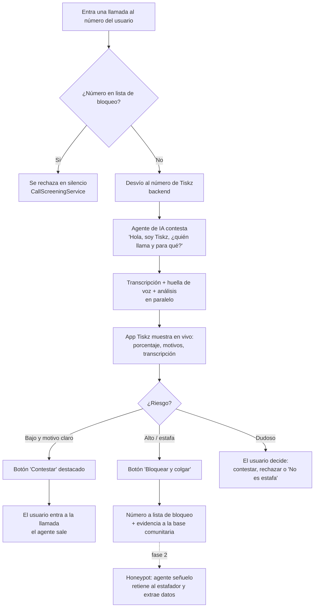
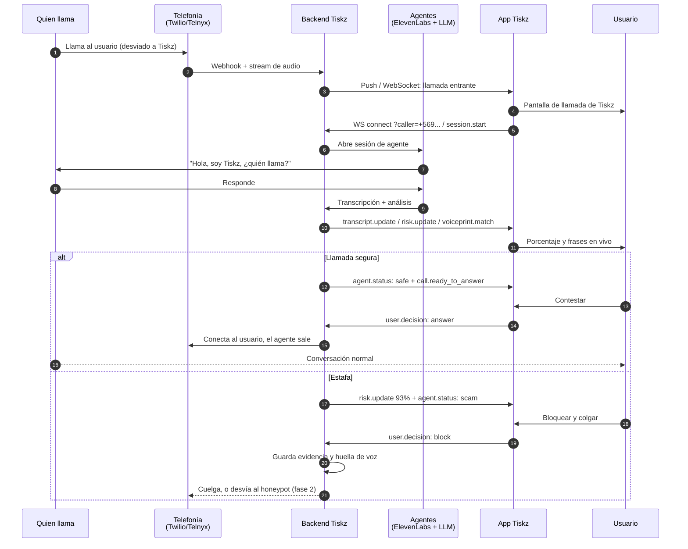
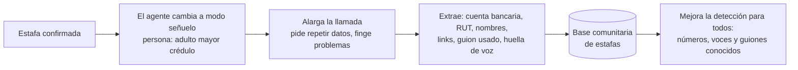
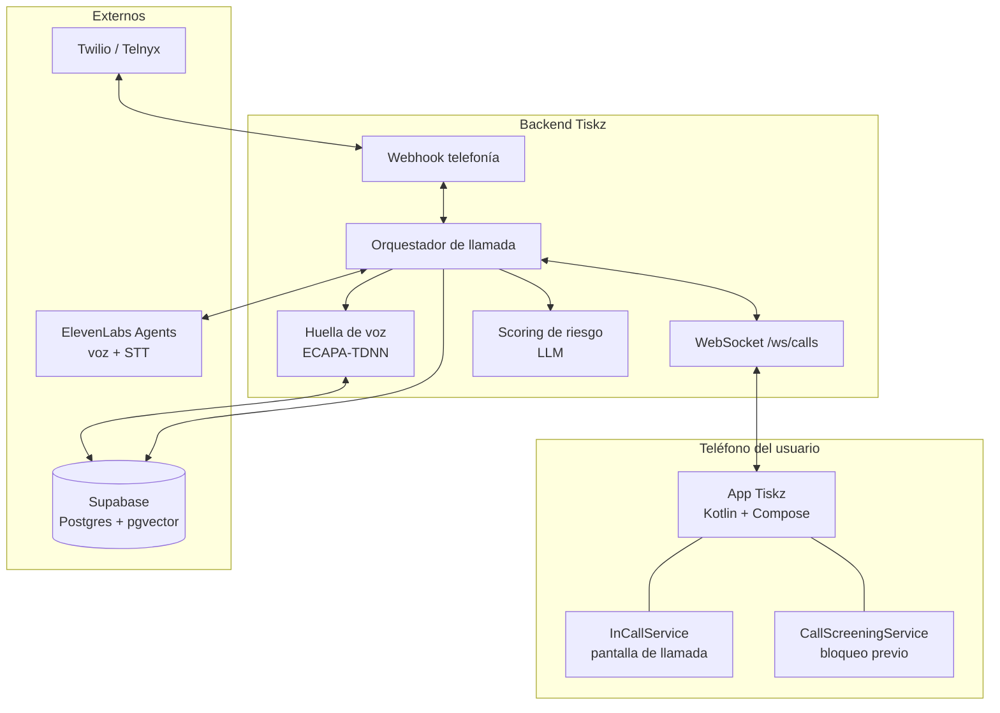

# Tiskz: análisis del proyecto y flujo

> Track: **Seguridad: extorsión, estafas, suplantación y desinformación**.
> Estado: app Android (interfaz) hecha con modo demo. Backend y agentes pendientes.

## Índice

1. [El problema](#1-el-problema)
2. [La propuesta](#2-la-propuesta)
3. [Flujo principal](#3-flujo-principal)
4. [Arquitectura](#4-arquitectura)
5. [Responsabilidades por componente](#5-responsabilidades-por-componente)
6. [Restricciones técnicas de Android](#6-restricciones-técnicas-de-android)
7. [Estado del arte](#7-estado-del-arte)
8. [Análisis de SafeLine (proyecto de referencia)](#8-análisis-de-safeline-proyecto-de-referencia)
9. [Stack y costos](#9-stack-y-costos)
10. [Aspectos legales y de seguridad](#10-aspectos-legales-y-de-seguridad)
11. [Estado actual y próximos pasos](#11-estado-actual-y-próximos-pasos)
12. [Fuentes](#12-fuentes)

---

## 1. El problema

Las estafas telefónicas en Chile y Latinoamérica afectan sobre todo a adultos mayores. Los patrones más comunes:

- **Familiar en apuros:** "Abuela, soy yo, tuve un accidente, necesito plata para el abogado".
- **Suplantación bancaria:** "Detectamos un cargo sospechoso, dígame la clave que le llegó por SMS".
- **Paquetería o aduana:** "Tiene un paquete retenido, pague el impuesto".
- **Premios y subsidios falsos:** "Ganó un auto, solo pague los gastos".
- **Soporte técnico falso:** "Instale AnyDesk para revisar su computador".
- **Inversiones con retorno garantizado.**

La respuesta habitual es **detectar y cortar**: el estafador pierde un intento, pero sigue llamando
a otras personas y no se aprende nada de él.

## 2. La propuesta

Tiskz va un paso más allá del "detecta y corta":

1. **Un agente de IA atiende primero.** El usuario no habla con un desconocido hasta que el agente verificó quién llama y para qué.
2. **El riesgo se ve en vivo.** La app muestra un porcentaje de estafa que sube o baja con cada frase, con sus motivos.
3. **Se reconoce la voz.** Se calcula una huella de voz de quien llama y se compara con voces ya reportadas como estafa.
4. **El usuario toma el control** solo cuando la llamada es segura. El agente sale y la llamada pasa a ser suya.
5. **Si es estafa, se aprovecha** (fase 2): en vez de colgar, la llamada se desvía a un **honeypot**, un agente que finge ser una víctima, alarga la llamada y registra evidencia (cuentas, nombres, guiones, voz).

Mensaje para el pitch:
> *Google avisa y Truecaller contesta. Tiskz contesta, te muestra el riesgo en vivo y, si es estafa,
> el estafador termina hablando con nuestro agente en vez de contigo.*

## 3. Flujo principal

### 3.1 Vista general

### 3.2 Secuencia de una llamada

### 3.3 Estados de la pantalla de llamada

| Estado del análisis | Qué ve el usuario | Botones |
|---|---|---|
| `connecting` / `screening` / `analyzing` | "Tiskz está atendiendo", medidor subiendo | Rechazar · Contestar ahora |
| Seguro (`safe` y riesgo < umbral) | Banner azul "Llamada segura" | **Contestar** · Rechazar |
| Estafa (`scam` o riesgo ≥ 70 %) | Banner rojo "Posible estafa" + tipo y a quién suplanta | **Bloquear y colgar** · Rechazar · No es estafa · Contestar de todos modos |
| Sin conexión con el análisis | Banner ámbar "Contesta con precaución" | Rechazar · Contestar ahora |
| Llamada en curso | Duración, transcripción | Silenciar · Colgar · Altavoz |

Colores del medidor: `< 30 %` azul · `30–59 %` ámbar · `60–84 %` naranja · `≥ 85 %` rojo.

### 3.4 Flujo del honeypot (fase 2)

Reglas del honeypot: nunca usa datos reales, nunca transfiere dinero, nunca devuelve llamadas al estafador.

### 3.5 Cómo llegan las llamadas al backend

| Opción | Cómo | Para la hackathon |
|---|---|---|
| **Desvío condicional** | `**61*` (no contesta), `**67*` (ocupado), `**62*` (sin cobertura) al número de Tiskz | Recomendado para la demo |
| Desvío total | `**21*+56XXXXXXXXX#` (se desactiva con `##21#`) | Todas las llamadas pasan por el agente |
| Número virtual Tiskz | El usuario usa un número nuevo por VoIP | Solo demo |
| Operador | Filtrado en la red | Visión futura |

## 4. Arquitectura

## 5. Responsabilidades por componente

| Componente | Quién | Hace | No hace |
|---|---|---|---|
| **App Tiskz** | Equipo móvil | Pantalla de llamada, medidor, transcripción, decisiones del usuario, bloqueo local, historial | No toca el audio de la llamada |
| **Backend** | Pendiente | Recibe la llamada, la conecta con el agente, junta los resultados y los envía a la app | — |
| **Agentes (ElevenLabs)** | Pendiente | Hablar con quien llama, transcribir, conducir la verificación | No entregan huella de voz ni porcentaje por sí solos |
| **Scoring (LLM)** | Pendiente | Porcentaje 0–100 con motivos, tipo de estafa, entidad suplantada | — |
| **Huella de voz** | Pendiente | Embedding de la voz de quien llama y búsqueda de similares | No detecta voces clonadas sin un anti-spoofing aparte |
| **Base de datos (Supabase/Neon)** | Externa | Llamadas, reportes, huellas (`pgvector`) | — |

Contrato exacto app ↔ backend: [`CONTRATO_BACKEND.md`](CONTRATO_BACKEND.md).

## 6. Restricciones técnicas de Android

- **Ser app de teléfono** (`RoleManager.ROLE_DIALER` + `InCallService`) da control de la **interfaz** de la llamada: contestar, rechazar, colgar, silenciar, altavoz y pantalla sobre el bloqueo. Es lo que hace Truecaller.
- **No da acceso al audio** de una llamada del operador. Las APIs de procesamiento de audio dentro del filtro de llamadas (`setShouldScreenCallViaAudioProcessing`, `enterBackgroundAudioProcessing`) están ocultas o reservadas al sistema. Desde Android 10 tampoco se puede grabar la llamada con el micrófono.
- **Consecuencia de diseño:** el audio para los agentes tiene que pasar por el backend (desvío). La app solo dibuja lo que el backend publica.
- **iOS** es más cerrado: solo permite identificar y bloquear números (CallKit). Por eso el MVP es solo Android.

## 7. Estado del arte

### Productos

| Producto | Qué hace | Diferencia con Tiskz |
|---|---|---|
| **Google Scam Detection (Pixel)** | Analiza la llamada en el propio teléfono con Gemini Nano y avisa durante la conversación. Se amplía a Samsung Galaxy S26. | Solo avisa: no contesta por ti, no hay honeypot y funciona solo en ciertos equipos. |
| **Google Fake Call Detection (jun. 2026)** | Detecta clones de voz de contactos con una verificación cifrada por RCS entre teléfonos con Teléfono de Google. | Verifica la identidad, no analiza la conversación. |
| **Truecaller Assistant** | Contesta por ti, transcribe en vivo y te deja tomar la llamada o marcarla como spam. | **El más parecido.** No muestra un porcentaje de riesgo ni tiene honeypot. |
| **iOS 26 / Samsung Smart Call** | Siri o el teléfono contestan llamadas desconocidas y muestran la transcripción. | El screening ya viene en el sistema operativo. |
| **O2 "Daisy" (2024)** | "Abuela" de IA que entretiene estafadores. Según O2, más de 1.000 retenidos, hasta 50 min por llamada. | **No intercepta:** usa números propios sembrados en listas de estafadores. Tiskz desviaría estafas reales de víctimas reales. |

### Investigación

- **Detección incremental** (arXiv 2609.20223): predicción que se actualiza durante la llamada para alertar antes de que termine. Respalda el medidor en vivo.
- **Palabras clave + LLM en tiempo real** (ESORICS 2026): 91,7 % de precisión semántica, con solo 96 llamadas de prueba.
- **Modelos pequeños** (arXiv 2506.06180): Llama3-8B con conocimiento experto en el prompt rinde parecido a GPT-4.
- **Benchmark LREC 2026:** los LLM aún fallan al reconocer la estructura de la conversación.
- **Falta de datos:** existen datasets en coreano, pero no se encontró ninguno en español o chileno. Es una oportunidad.
- **Huella de voz:** ECAPA-TDNN es el estándar. La verificación de hablante sola no detecta voces clonadas: hace falta un detector anti-spoofing aparte.

### Qué diferencia a Tiskz

Ningún producto junta las cinco cosas:

1. Porcentaje de riesgo en vivo **con explicación**.
2. El agente atiende primero y **el usuario toma el control** si es segura.
3. **Honeypot con llamadas reales** desviadas desde las víctimas.
4. **Base de huellas de voz** de estafadores.
5. Enfoque en **Chile**: patrones locales en español.

## 8. Análisis de SafeLine (proyecto de referencia)

Repo: [platanus-hack/platanus-hack-25-team-6](https://github.com/platanus-hack/platanus-hack-25-team-6). FastAPI + React + MongoDB + Twilio.

Su flujo: llamada a un número Twilio → stream de audio → OpenAI Realtime (Whisper) transcribe → cada 3 frases Claude analiza → si el riesgo es alto, reproduce un audio de advertencia en la llamada y manda WhatsApp.

### Se reutiliza

| Qué | Para qué |
|---|---|
| Contrato de eventos (`call.started`, `transcript.update`, `analysis.complete`…) | Base del contrato de Tiskz |
| **Prompt de detección con estafas chilenas** y ejemplos calibrados | Para el equipo de agentes: es lo más valioso del repo |
| Idea de verificar con el contacto suplantado ("¿Eres tú quien llama?") | Funcionalidad futura |
| Pipeline Twilio → transcripción → análisis | Para el backend, si se usa Twilio |

### No se reutiliza

- **Frontend React/PWA:** Tiskz es nativo.
- **Autenticación:** usa una clave JWT por defecto en el código.
- **Alertas por WhatsApp:** se envían a **todos** los usuarios registrados, no solo al dueño de la línea.
- **Análisis por categoría** (`low…critical`): Tiskz necesita un porcentaje.
- **Transcripción sin separar hablantes:** todo queda como un mismo hablante.
- **Webhooks sin validar la firma de Twilio, y endpoints de monitoreo sin autenticación.**
- **`audioop`** (eliminado en Python 3.13), modelos de Claude antiguos y credenciales por defecto de Mongo y MinIO.
- **Verificación de contactos incompleta:** la respuesta del contacto no dispara nada (`TODO`).

## 9. Stack y costos

| Capa | Elección | Costo |
|---|---|---|
| App | Kotlin + Jetpack Compose + Material 3 | Gratis |
| Tiempo real app ↔ backend | WebSocket (OkHttp) | Gratis |
| Telefonía | Twilio, Telnyx o SignalWire (SignalWire es compatible con TwiML) | Número unos USD/mes + centavos por minuto. Revisar disponibilidad de +56 |
| Agente de voz | ElevenLabs Agents (cuenta del equipo) | Según el plan del equipo |
| Scoring | Claude Haiku u otro LLM | Bajo |
| Huella de voz | SpeechBrain ECAPA-TDNN | Gratis (open source) |
| Base de datos | Supabase (recomendado: Realtime + `pgvector`) o Neon | Plan gratuito |
| Alternativas abiertas | Jambonz, FreeSWITCH, LiveKit (con SIP) | Software gratis, pero hay que operarlo |

## 10. Aspectos legales y de seguridad

- **Consentimiento:** el usuario activa Tiskz explícitamente. Conviene que el agente avise al inicio: "llamada atendida por un asistente automático".
- **Grabación:** en Chile la grabación de comunicaciones privadas está regulada. Hay que validarlo antes de presentarlo como producto.
- **Biometría:** la huella de voz es un dato biométrico. Guardar solo el embedding, no el audio, con retención limitada y acceso controlado.
- **Honeypot:** no usar datos reales, no transferir dinero, no llamar al estafador. Solo recibir y registrar.
- **Falsos positivos:** existe el botón "No es estafa", y el usuario siempre puede contestar igual.

## 11. Estado actual y próximos pasos

### Hecho

- [x] App Android Tiskz: bienvenida, inicio, llamada en vivo, detalle, marcador y ajustes.
- [x] Tiskz como app de teléfono (`InCallService`) y bloqueo previo (`CallScreeningService`).
- [x] Modo demo con guiones de estafa y de llamada segura.
- [x] Cliente WebSocket y [contrato con el backend](CONTRATO_BACKEND.md).

### Pendiente

- [ ] Probar la app en un dispositivo real y ajustar detalles visuales.
- [ ] Backend: webhook de telefonía, orquestador y WebSocket `/ws/calls`.
- [ ] Agente ElevenLabs para el screening.
- [ ] Scoring 0–100 (reutilizando el prompt de SafeLine).
- [ ] Huella de voz y base en Supabase.
- [ ] Configurar el número y el desvío de llamadas.
- [ ] Fase 2: honeypot.

### Guion de demo sugerido

1. Abrir Tiskz y mostrar "Protección activa".
2. **Llamada de estafa:** el agente atiende, el porcentaje sube a 93 %, aparece la coincidencia de voz y se toca "Bloquear y colgar".
3. **Llamada segura:** el riesgo baja, aparece "Llamada segura" y se toca "Contestar".
4. Mostrar el historial con ambos veredictos.
5. Cerrar con la visión del honeypot y la base comunitaria.

## 12. Fuentes

- [Google: New AI-Powered Scam Detection Features](https://blog.google/security/new-ai-powered-scam-detection-features/)
- [Google: Strengthening Android's lead in scam protection](https://blog.google/security/staying-one-step-ahead-strengthening-androids-lead-in-scam-protection/)
- [Google: Fake call detection](https://blog.google/security/android-fake-call-detection/)
- [Google: New Android scam protections (oct. 2026)](https://blog.google/security/new-android-scam-protections/)
- [Engadget: Live scam detection on Pixel](https://www.engadget.com/mobile/smartphones/googles-live-scam-detection-for-phone-calls-is-now-out-for-pixel-devices-143017096.html)
- [BleepingComputer: Android deepfake scam call protection](https://www.bleepingcomputer.com/news/security/google-adds-android-protection-against-ai-deepfake-scam-calls/)
- [YourStory: Truecaller Assistant](https://yourstory.com/2023/07/truecaller-assistant-launches-india-ai-powered-call-screening-android)
- [Android Developers: Telecom framework](https://developer.android.com/develop/connectivity/telecom)
- [Android: CallScreeningService.CallResponse.Builder](https://developer.android.com/reference/android/telecom/CallScreeningService.CallResponse.Builder.html)
- [AOSP: background call screening](https://gerrit.omnirom.org/plugins/gitiles/android_frameworks_base/+/6dfa249c882e04f9b14e578235c67cb20dde385b%5E%21)
- [CNN: O2 AI granny Daisy](https://www.cnn.com/2024/11/26/business/daisy-ai-granny-scammers-o2-intl)
- [Marketing Week: O2's AI granny stopped 1,000 scammers](https://www.marketingweek.com/o2-ai-granny-scammers-public/)
- [arXiv 2609.20223: Incremental Phone-Scam Detection from Speech](https://arxiv.org/pdf/2609.20223)
- [arXiv 2506.06180: Small LMs for voice phishing](https://arxiv.org/pdf/2506.06180)
- [ESORICS 2026 (Jia et al.)](https://www.medien.ifi.lmu.de/pubdb/publications/pub/jia2026esorics/jia2026esorics.bib)
- [LREC 2026: Voice phishing benchmark](https://aclanthology.org/2026.lrec-1.585/)
- [NAACL 2025 Industry: Korean phishing dataset](https://preview.aclanthology.org/vol-to-evt/2025.naacl-industry.18.pdf)
- [NVIDIA NeMo ECAPA-TDNN](https://catalog.ngc.nvidia.com/orgs/nvidia/nemo/models/ecapa_tdnn/v1)
- [arXiv 2209.14098: Deepfake audio detection by speaker verification](https://arxiv.org/pdf/2209.14098)
